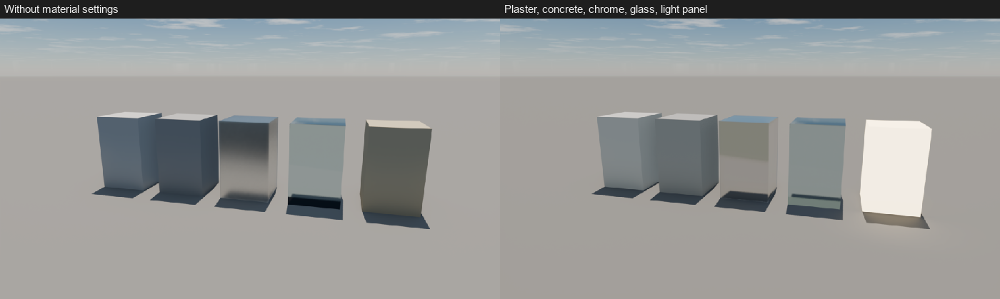
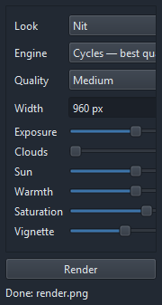

# Render Studio for IngeTrazo

Photographic renders from IngeTrazo with one click: pick a look, press
**Render**, then fine-tune the image live without rendering again.

It drives the same Blender that IngeTrazo's own Render tab uses (Blender
4.2+; tested with 5.3), with IngeTrazo's scene script plus
`blender/studio_scene.py` for the look.


## Looks

| Look | What it does |
|---|---|
| Clear day | Physical sky, sun coloured by its height, a few clouds |
| Partly cloudy | More cloud, softer sun |
| Golden hour | Low warm sun (7°), long shadows, punchier contrast |
| Overcast | Soft sun through full cloud cover, low contrast |
| White model | Every material white (study model), neutral finish |
| Interior | Exposed for the room, window allowed to burn out; switches to **Cycles** (EEVEE can't fill a window-lit room) |
| Night | Moonlight kept dark, stars and moonlit clouds; the document's lamps glow (light bloom) |

Every look shares:
- **Automatic exposure.** A quarter-size pre-render is metered, with a
  centre-weighted average and highlights protected.
- **AgX** tone mapping with white balance.
- **Distance haze.** The ground fades into the horizon sky.
- **Albedo capped at 80 %.** Paper-white surfaces don't glow under a path tracer.
- **Finish.** A light saturation and vignette pass in Blender's compositor.
- **EEVEE gets a ground below the horizon in its world.** Its reflections
  and the light bounced off the ground then match Cycles.

## Materials

**Materials…**, on the panel or in the menu, opens a simple material
editor. The list shows the materials used in the model.
**From the selection** jumps to the material of the selected face or group.

For each material you can:
- start from a preset: matte plaster, satin paint, gloss lacquer, polished
  stone, concrete, brick, varnished or raw wood, fabric, brushed metal,
  chrome, clear or frosted glass, water, or a light panel;
- set its **type**: generic, glass, water or glowing;
- adjust **Roughness**, **Metal**, **Relief** and **Glow**, each with an optional map.

Relief comes from the material's picture when it has one (mortar joints,
wood grain), otherwise from a fine grain. With the picture, the **Relief** slider is the height of the relief, up to 3 cm from black to
white, at full strength. The picture is first turned into a smooth height map (reduced to at most
1024 px, blurred, stretched to use the whole range, inverted and given contrast if asked): used
raw, its grain became noise and a joint a pixel or two wide gave only a thin outline (0.5.x to
0.7.0 did that; 0.7.1 only made it stronger). It shows where the picture changes clearly; for
gentle changes (wood grain) raise the map's contrast or use a height map. A glowing material lights what
is around it, and the exposure meter ignores it, so it doesn't darken the
picture.

### Transparency

The **Transparency** slider (0 = opaque, up to 95 %) sets how much light the material lets
through, **in the IngeTrazo model itself**: the opacity of the registry material, of every face
that wears it (nested components included) and of every object painted whole, as one undo step.
The 3D view shows it and so does the render, because the render reads the same value (a see-through
water shows the floor below, tinted by the material's colour or picture). For **Glass** the slider
is also how much the refracting glass transmits. Choosing the Water or Glass type, or their presets,
gives a transparency to start with. (Before 0.9.0 the Water type only changed the finish, and a sea
texture painted opaque stayed opaque.) With «Change picture…» these are the only controls that edit
IngeTrazo's own material; every other setting only affects the render.

### Water

For the **Water** type, **Relief** is the height of the ripples and **Ripple size** their size,
from fine to broad waves. They follow the «easiest water in Blender» recipe: a 3-D noise (detail
16, roughness 0.442, scale 108.6 at the finest) turned into a bump (distance 0.1 at the maximum
relief) on the glossy surface, laid out in world metres so a ripple has the same size everywhere.
Fine ripples read as grain from far away; the default (0.8, about 7 waves a metre) reads as water
and makes the sun glint. Relief 0 gives a flat, mirror-like water. Materials saved before 0.8.0
keep IngeTrazo's own ripples until their settings are changed here.

### Cube preview

The material editor shows the material on a **one-metre cube**, drawn on the CPU, so it follows
the sliders instantly and needs no Blender. It uses the picture and its tile size, the colour,
the type (glass and water see-through, glowing ones with a halo) and the Roughness, Metal,
Relief and Glow sliders. It is an approximation: the maps and Blender's lighting only show in
the render.

### Change the picture, in the model

**Change picture…** in the material editor replaces the picture of the material **in the
IngeTrazo model itself**, not only in the render: every face, component and object that wears
the material changes, in the viewport too, as one undo step. Each face keeps where its texture
was placed, and a colour tint is kept over the new image. **Keep proportions** makes the tile
height follow the new image's shape. The new image is copied into IngeTrazo's texture cache and
travels with the document. It needs a material that already has a picture. This is the one
control of Render Studio that edits IngeTrazo's own material; every other setting only affects
the render.

### Maps

Each setting can vary over the surface by following a map. The setting's
slider then scales the map. A map can come from:
- **Picture (B/W)**: the material's own texture in black and white. For
  example, a wood texture's grain for its roughness and relief.
- **Image file**: a roughness, metal or height map, or a mask for where it
  glows. Relief also takes a **normal map**.

Every map can be **inverted** and given more **contrast**, and a small
preview shows what the render will read. Map files follow the picture's
own size and placement. On a material without a picture, they tile at the
**Map image size**.


The settings are saved in the document, one undo step per change. **Back
to automatic** returns the material to IngeTrazo's own finish. Map files
are linked by their path, not embedded in the document.

### Grass

A material of type **Grass** grows blades of grass on every face that wears it, **in the render only**
(the model stays flat). **Grass height** sets how tall they are (1–60 cm); the **Lawn** (6 cm) and
**Tall grass** (30 cm) presets start from there. In Blender they are tufts of a few bent blades
scattered by geometry nodes over the faces of that material (instanced: a lawn costs little memory),
upright, turned and sized at random; their colour is the material's picture read at each tuft's UVs,
else its colour, darker at the root. Short grass gets 260 tufts per m², taller grass fewer and bigger;
past 250 000 tufts in one render the whole lawn is thinned (the log says by how much). The job carries
it in the material's settings: `{"type": "grass", "grass_height": 0.08}`.

### Full texture sets (normal, roughness, AO, displacement, metalness, opacity)

IngeTrazo gives a face only its colour picture. When that picture has companion maps beside it,
the render builds the full material from them by itself (Principled BSDF), read with the picture's
own UVs (same tile size and rotation). They are found, in this order:

1. A manifest next to the picture, `<picture stem>.pbr.json` (the asset panel writes it for its
   Poly Haven and ambientCG downloads):

   ```
   {"version": 1, "color": "wood_floor_diff_1k.jpg",
    "normal_gl": "...", "normal_dx": "...", "roughness": "...", "ao": "...",
    "displacement": "...", "metalness": "...", "opacity": "...",
    "arm": "...",                 # AO / roughness / metalness packed in R / G / B
    "size_m": [w, h], "source": "polyhaven|ambientcg", "id": "<asset id>"}
   ```

   Every key but `version` and `color` is optional. Files are relative to the manifest's folder
   and must stay inside it: an absolute path, a `..` or a missing file is dropped (the rest of the
   manifest still counts). Another `version`, no `color` or bad JSON: the manifest is ignored.
2. No manifest: the libraries' own file names, in the picture's folder (any of .png/.jpg/.exr/.tif):
   **Poly Haven** `<id>_diff_<res>` → `<id>_nor_gl_<res>`, `_nor_dx_`, `_rough_`, `_ao_`,
   `_disp_`, `_metal_`, `_arm_`; **ambientCG** `<id>_<res>-JPG_Color` (or `-PNG_`) → `_NormalGL`,
   `_NormalDX`, `_Roughness`, `_AmbientOcclusion`, `_Displacement`, `_Metalness`, `_Opacity`.
3. Nothing found: the picture alone, exactly as before.

A tinted picture looks for the maps of its original. The material editor shows the set: a line lists the
maps found, and the first choice of Roughness, Metal and Relief becomes «Texture set: …» with a preview
of that map; choosing another one there replaces it. In the render:
- **Normal**: the OpenGL map; else the DirectX one with its green flipped. It replaces the
  *automatic* relief guessed from the picture; a relief source chosen in the editor stays, on top.
  Without a normal map the **displacement** map is the relief (a bump, 1 cm black to white).
  True displacement is not used: it would need the model subdivided.
- **Roughness**: the map × (the editor's Roughness / 0.5); a roughness map chosen in the editor wins.
- **Metalness**: the map, with the editor's Metal as its floor; a metal map chosen in the editor wins.
- **Ambient occlusion** multiplies the colour (75 %); **opacity** drives the alpha.
- `arm` fills in whichever of AO / roughness / metalness has no map of its own.
- Glass and water take only the normal map; the white model ignores the sets.

The job carries them as `studio.pbr = {picture file name: {"normal": abs path, "normal_flip_green":
bool, "roughness": …}}` (`render_studio/pbr.py`, no Qt, no Blender); `studio_scene.py` matches
them to the imported materials by the picture's name.




## 360° background (HDRI)

Any equirectangular image (.hdr, .exr, .jpg) as the world:
- **Lights the scene** (on): the image lights the model, and its sun casts
  the shadows. The look's sky and sun are replaced; its exposure and
  finish stay.
- **Lights the scene** (off): the look lights the model, and the image is
  only what the camera sees behind it.
- **Rotation** turns the image, and **Brightness** sets it in stops.
- The ground melts into the image's horizon.

Blender's own eight HDRIs (CC0, Poly Haven) are offered in the list. They
are 1K: good light, but soft behind the model. For a sharp background,
choose a 4K or larger file, for example a free one from polyhaven.com.


## Panel

`Render Studio…` in the extensions menu opens the panel. It has:
- the look;
- the engine: EEVEE (fast, about 3 s) or Cycles (best, about 5 s on an RTX GPU);
- the quality and the width;
- sliders that change the render itself: exposure (EV), clouds, sun, warmth,
  saturation and vignette;
- a 360° background (HDRI), with rotation, brightness and "Lights the scene".

The finished image opens in its own window. There you can adjust
exposure, contrast, saturation, warmth and vignette instantly, then save
the image as PNG or JPEG.



## Live view

**Live view** (a box in the panel) keeps Blender open with the scene and the look loaded, and a
draft image follows the 3D view: move the camera and stop, and it updates. Changing the model,
the look, a slider, the 360° background or a material setting loads the scene again. It speaks
the protocol of IngeTrazo's own «Sync with the view» (Blender in `serve` mode), so the draft has
the look, sky and materials of the final render, at draft quality. **Render** closes the live
Blender first and leaves the live view off, so the draft does not cover the final image.

## Settings in the document

The panel's settings are saved in the IngeTrazo document (a moment after each change, one undo
step per pause, and only when something changed): `scene.plugin_data["render_studio"]`, saved in
the `.igz`. Tabs and reopened files show their own; undo and redo move them. The format is
meant to be read by other tools, such as IngeTrazo's own Blender render (its Render tab does not
apply them yet: that needs a change in IngeTrazo):

```
plugin_data["render_studio"] = {
  "materials": { "<material name>": { …render settings of that material… } },
  "settings": {
    "version": 1,
    "look": "clear",            # clear partly_cloudy golden_hour overcast white_model interior night
    "engine": "eevee",          # or "cycles"
    "quality": 1,               # 0 draft, 1 medium, 2 high
    "width": 1920,              # pixels; the height follows the 3D view
    "sliders": { "exposure_bias": 0.0, "clouds": 0.25, "sun_scale": 1.0,
                 "warmth": 0.0, "saturation": 1.06, "vignette": 0.16 },
    "hdri": null                # or {"path": "...", "rotation": 0..360, "brightness": stops, "light": true}
  } }
```

`render_studio/settings_store.py` reads and cleans it (unknown looks fall back, numbers are
clamped) and has no Qt dependency.

## Help

A **?** button in the panel, in the image window and in the material editor opens a help
window (with search) at the right section: how Render Studio works, every control, the looks,
the 360° background, the image adjustments, the material editor with its maps and starting
points, and a few tips.

## Releases

The packaged extension of each version is in `releases/` and tagged (`v0.9.1` → `releases/render_studio-0.9.1.zip`),
so the catalog can pin the exact file by tag and SHA-256. Unpack it in IngeTrazo's plugins folder, or install it from
**Extensions ▸ Manage extensions…**.

## Install

Copy the `render_studio` folder into IngeTrazo's plugins folder
(`%APPDATA%\IngeTrazo\plugins` on Windows), then restart IngeTrazo. It
requires Extension API 2 and a Blender that IngeTrazo can find (set in the
Render tab).

## Tests

- `tests/test_opacity_offline.py` checks the transparency in the model (reach, undo, the editor); `tests/test_opacity_e2e.py` goes IngeTrazo → GLB → real Blender and checks the floor shows through (needs `BPY_PYTHON`).
- `tests/test_water_editor_offline.py` checks the water controls of the editor.
- `tests/test_relief_bpy.py` renders a brick wall and a pool with a REAL Blender (the `bpy` module, `pip install bpy`) with and without relief and checks the height map and the difference; skipped when `bpy` is missing.
- `tests/test_cube_preview_offline.py` checks the cube preview (picture, tile, colour, polish, metal, relief, glass, glow) and its wiring in the editor.
- `tests/test_live_offline.py` runs the live view against a stand-in for Blender (`tests/fake_blender.py`, same protocol): first draft, camera moves, model/look changes, a final render, switching off.
- `tests/test_doc_settings_offline.py` checks the settings kept in the document.
- `tests/test_materials_list_offline.py` checks the material list (faces, groups painted whole, nested, registry).
- `tests/test_texture_swap_offline.py` changes a material's picture on loose faces, nested
  components and painted objects, and checks placement, proportions, tint, undo and save/reopen.
- `tests/test_help_offline.py` checks the help against the code.
- `tests/test_grass_sets_editor_offline.py` checks the Grass type in the editor (height slider, presets, cube
  preview) and how the editor shows a picture's texture set.
- `tests/test_grass_blender.py` renders a lawn with a real Blender (EEVEE and Cycles): the blades grow on the lawn
  only, take its picture's colour where they stand, follow the height slider and leave the model's mesh alone.
- `tests/test_pbr_offline.py` (plain Python) finds texture sets by manifest and by the two libraries' names,
  refuses manifest entries that leave the picture's folder, and collects the model's pictures.
- `tests/test_pbr_job_offline.py` writes a job with the panel's own code and IngeTrazo's own GLB (a set on a
  loose face and one on a tinted, painted group); given `blender.exe` it renders it and checks Blender found both.
- `tests/test_pbr_blender.py` runs in Blender (`blender -b --factory-startup --python tests/test_pbr_blender.py --
  <repo> <render_scene.py> <out dir>`): two small sets (Poly Haven and ambientCG style) rendered with and without
  them in EEVEE and Cycles, the nodes checked, and a DirectX normal map shown to render like the OpenGL one.
- `tests/test_offline.py` writes a job with the panel's own code and
  renders it with Blender. It then adjusts and saves the image in the image
  window, without IngeTrazo running.
- `selftest.py` runs inside a real, separate IngeTrazo. Start it with
  `RENDER_STUDIO_SELFTEST=<config.json> ingetrazo --new-window`. It
  renders every look through the Render button code, saves the pictures
  and quits without saving.

## Licence

GPL-3.0-or-later, like IngeTrazo.
