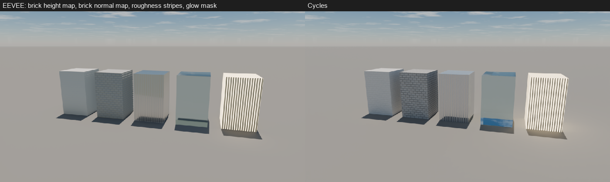
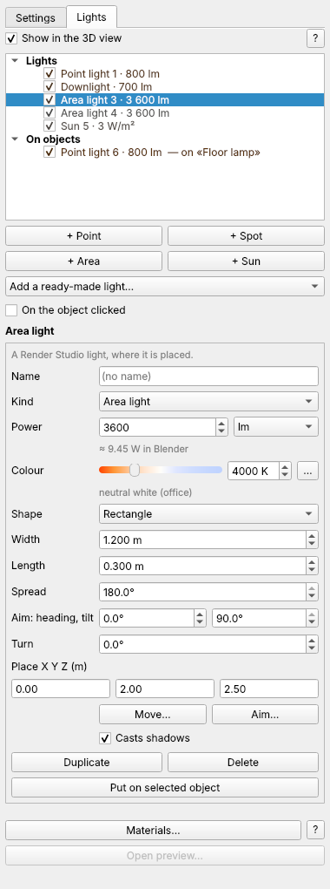
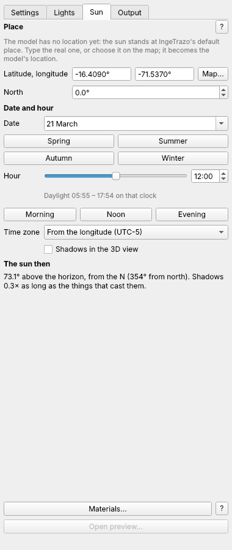
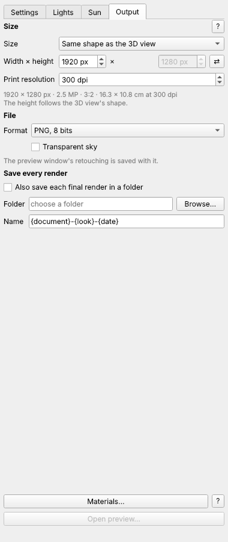
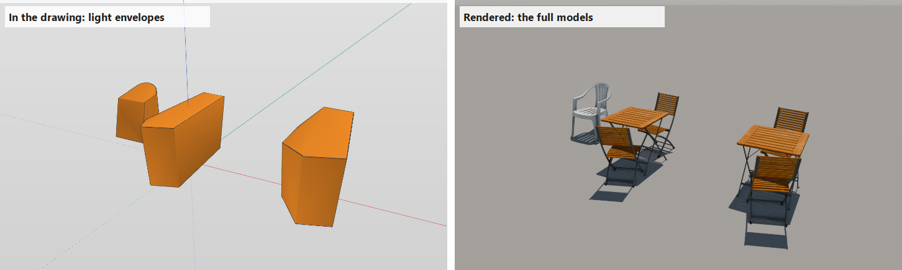
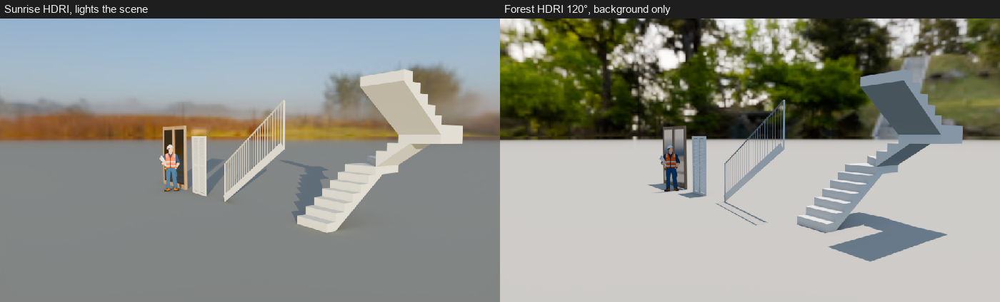
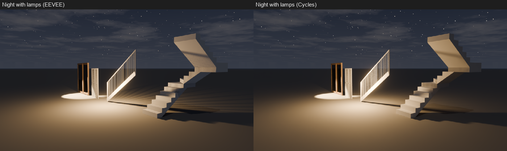
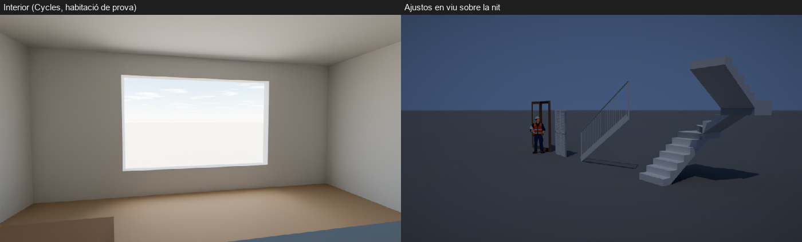

# Render Studio for IngeTrazo

Photographic renders from IngeTrazo: pick a look, watch it in a live preview you can zoom and
move, press **Render**, then fine-tune the picture without rendering again.

It drives the same Blender that IngeTrazo's own Render tab uses (Blender
4.2+; tested with 5.3), with IngeTrazo's scene script plus
`blender/studio_scene.py` for the look.

When IngeTrazo finds no Blender, the panel says so at the top: a path box with **Browse…** (a
macOS `Blender.app` is fine), a link to blender.org's download page and, on Linux packages
(Flatpak, Snap), the exact install command. The chosen program is asked for its version (4.2 or
newer) and saved under IngeTrazo's own key (`render/blender_path`), so the Render tab uses it too.
**Open preview…** stays off until there is one.


## Looks

| Look | What it does |
|---|---|
| Clear day | Physical sky, sun coloured by its height, a few clouds |
| Partly cloudy | More cloud, softer sun |
| Golden hour | Low warm sun (7°), long shadows, punchier contrast |
| Overcast | Soft sun through full cloud cover, low contrast |
| White model | Every material white (study model), neutral finish |
| Interior | Exposed for the room, window allowed to burn out; switches to **Cycles** (EEVEE can't fill a window-lit room) |
| Night | Moonlight kept dark, stars and moonlit clouds; the document's lamps glow (light bloom) |

Every look shares:
- **Automatic exposure.** A quarter-size pre-render is metered, with a
  centre-weighted average and highlights protected.
- **AgX** tone mapping with white balance.
- **Distance haze.** The ground fades into the horizon sky.
- **Albedo capped at 80 %.** Paper-white surfaces don't glow under a path tracer.
- **Finish.** A light saturation and vignette pass in Blender's compositor.
- **EEVEE gets a ground below the horizon in its world.** Its reflections
  and the light bounced off the ground then match Cycles.

## Materials

**Materials…**, on the panel or in the menu, opens a simple material
editor. The list shows the materials used in the model.
**From the selection** jumps to the material of the selected face or group.

For each material you can:
- start from a preset: matte plaster, satin paint, gloss lacquer, polished
  stone, concrete, brick, varnished or raw wood, fabric, brushed metal,
  chrome, clear or frosted glass, water, or a light panel;
- set its **type**: generic, glass, water or glowing;
- adjust **Roughness**, **Metal**, **Relief** and **Glow**, each with an optional map.

Relief comes from the material's picture when it has one (mortar joints,
wood grain), otherwise from a fine grain. With the picture, the **Relief** slider is the height of the relief, up to 3 cm from black to
white, at full strength. The picture is first turned into a smooth height map (reduced to at most
1024 px, blurred, stretched to use the whole range, inverted and given contrast if asked): used
raw, its grain became noise and a joint a pixel or two wide gave only a thin outline (0.5.x to
0.7.0 did that; 0.7.1 only made it stronger). It shows where the picture changes clearly; for
gentle changes (wood grain) raise the map's contrast or use a height map. A glowing material lights what
is around it, and the exposure meter ignores it, so it doesn't darken the
picture.

### Transparency

The **Transparency** slider (0 = opaque, up to 95 %) sets how much light the material lets
through, **in the IngeTrazo model itself**: the opacity of the registry material, of every face
that wears it (nested components included) and of every object painted whole, as one undo step.
The 3D view shows it and so does the render, because the render reads the same value (a see-through
water shows the floor below, tinted by the material's colour or picture). For **Glass** the slider
is also how much the refracting glass transmits. Choosing the Water or Glass type, or their presets,
gives a transparency to start with. (Before 0.9.0 the Water type only changed the finish, and a sea
texture painted opaque stayed opaque.) With «Change picture…» these are the only controls that edit
IngeTrazo's own material; every other setting only affects the render.

### Water

For the **Water** type, **Relief** is the height of the ripples and **Ripple size** their size,
from fine to broad waves. They follow the «easiest water in Blender» recipe: a 3-D noise (detail
16, roughness 0.442, scale 108.6 at the finest) turned into a bump (distance 0.1 at the maximum
relief) on the glossy surface, laid out in world metres so a ripple has the same size everywhere.
Fine ripples read as grain from far away; the default (0.8, about 7 waves a metre) reads as water
and makes the sun glint. Relief 0 gives a flat, mirror-like water. Materials saved before 0.8.0
keep IngeTrazo's own ripples until their settings are changed here.

### Cube preview

The material editor shows the material on a **one-metre cube**, drawn on the CPU, so it follows
the sliders instantly and needs no Blender. It uses the picture and its tile size, the colour,
the type (glass and water see-through, glowing ones with a halo) and the Roughness, Metal,
Relief and Glow sliders. It is an approximation: the maps and Blender's lighting only show in
the render.

### Change the picture, in the model

**Change picture…** in the material editor replaces the picture of the material **in the
IngeTrazo model itself**, not only in the render: every face, component and object that wears
the material changes, in the viewport too, as one undo step. Each face keeps where its texture
was placed, and a colour tint is kept over the new image. **Keep proportions** makes the tile
height follow the new image's shape. The new image is copied into IngeTrazo's texture cache and
travels with the document. It needs a material that already has a picture. This is the one
control of Render Studio that edits IngeTrazo's own material; every other setting only affects
the render.

### Maps

Each setting can vary over the surface by following a map. The setting's
slider then scales the map. A map can come from:
- **Picture (B/W)**: the material's own texture in black and white. For
  example, a wood texture's grain for its roughness and relief.
- **Image file**: a roughness, metal or height map, or a mask for where it
  glows. Relief also takes a **normal map**.

Every map can be **inverted** and given more **contrast**, and a small
preview shows what the render will read. Map files follow the picture's
own size and placement. On a material without a picture, they tile at the
**Map image size**.



The settings are saved in the document, one undo step per change. **Back
to automatic** returns the material to IngeTrazo's own finish. Map files
are linked by their path, not embedded in the document.

### Grass

A material of type **Grass** grows blades of grass on every face that wears it, **in the render only**
(the model stays flat). **Grass height** sets how tall they are (1–60 cm); the **Lawn** (6 cm) and
**Tall grass** (30 cm) presets start from there. In Blender they are tufts of a few bent blades
scattered by geometry nodes over the faces of that material (instanced: a lawn costs little memory),
upright, turned and sized at random; their colour is the material's picture read at each tuft's UVs,
else its colour, darker at the root. Short grass gets 260 tufts per m², taller grass fewer and bigger;
past 250 000 tufts in one render the whole lawn is thinned (the log says by how much). The job carries
it in the material's settings: `{"type": "grass", "grass_height": 0.08, "grass_density": 260}`.

**Grass density** (0.11.0) is the tufts per m², 20–800 (Lawn preset 260, Tall grass 90). The live
view grows the same grass as the render (before 0.11.0 it had a third of it). A material saved
without a density gets the old automatic one for its height. Past 600 000 tufts in one render the
whole lawn is thinned, and Blender's log says by how much.

### Recognised by the name

A material with no settings of its own whose name, or its picture's file name, says what it is gets
that preset, in the editor and in the render job (`materials.detect_preset` / `with_detected`):
**Water** (aigua, agua, água, water, wasser, eau, piscina, pool, mar, llac, lago, estany…),
**Clear glass** (vidre, vidrio, glass, glas, cristal, verre…), **Tall grass** (herba alta, hierba
alta, tall grass, prat, prado, meadow…), **Lawn** (gespa, césped, grass, herba, lawn, rasen,
pelouse…) and **Light panel** (llum, luz, LED, neon, làmpada, lámpara, emissive…). Whole words or
word starts, camel case split («WaterBlue»), short words must end there (Mar ≠ Marbre, Glas ≠
Glasur, Led ≠ Ledge). The list marks such materials ◦; the editor shows the preset with a note and
writes nothing until a setting changes (then ●). The model's transparency is left alone.

### Only what matters is shown

The editor hides the controls that do nothing for the material as it is set
(`materials.shown_controls`, which follows what `studio_scene.py` does): Metal only for Generic;
Glow for Glowing; Ripple size for Water (whose Relief is the waves' height, with no relief map);
grass height and density for Grass (no Transparency there); the Relief slider while a texture set
gives the relief and no relief map is chosen; **Map image size** only for a map file on a material
without a picture; **Change picture…** only with a picture; Invert and contrast only for a
black-and-white map; «Picture (B/W)» can't be chosen without a picture. For Glass and Water the
texture set offers only its normal map, the only one the render uses on them. The map of a hidden
setting is not saved.

### Full texture sets (normal, roughness, AO, displacement, metalness, opacity)

IngeTrazo gives a face only its colour picture. When that picture has companion maps beside it,
the render builds the full material from them by itself (Principled BSDF), read with the picture's
own UVs (same tile size and rotation). They are found, in this order:

1. A manifest next to the picture, `<picture stem>.pbr.json` (the asset panel writes it for its
   Poly Haven and ambientCG downloads):

   ```
   {"version": 1, "color": "wood_floor_diff_1k.jpg",
    "normal_gl": "...", "normal_dx": "...", "roughness": "...", "ao": "...",
    "displacement": "...", "metalness": "...", "opacity": "...",
    "arm": "...",                 # AO / roughness / metalness packed in R / G / B
    "size_m": [w, h], "source": "polyhaven|ambientcg", "id": "<asset id>"}
   ```

   Every key but `version` and `color` is optional. Files are relative to the manifest's folder
   and must stay inside it: an absolute path, a `..` or a missing file is dropped (the rest of the
   manifest still counts). Another `version`, no `color` or bad JSON: the manifest is ignored.
2. No manifest: the libraries' own file names, in the picture's folder (any of .png/.jpg/.exr/.tif):
   **Poly Haven** `<id>_diff_<res>` → `<id>_nor_gl_<res>`, `_nor_dx_`, `_rough_`, `_ao_`,
   `_disp_`, `_metal_`, `_arm_`; **ambientCG** `<id>_<res>-JPG_Color` (or `-PNG_`) → `_NormalGL`,
   `_NormalDX`, `_Roughness`, `_AmbientOcclusion`, `_Displacement`, `_Metalness`, `_Opacity`.
3. Nothing found: the picture alone, exactly as before.

A tinted picture looks for the maps of its original. The material editor shows the set: a line lists the
maps found, and the first choice of Roughness, Metal and Relief becomes «Texture set: …» with a preview
of that map; choosing another one there replaces it. In the render:
- **Normal**: the OpenGL map; else the DirectX one with its green flipped. It replaces the
  *automatic* relief guessed from the picture; a relief source chosen in the editor stays, on top.
  Without a normal map the **displacement** map is the relief (a bump, 1 cm black to white).
  True displacement is not used: it would need the model subdivided.
- **Roughness**: the map × (the editor's Roughness / 0.5); a roughness map chosen in the editor wins.
- **Metalness**: the map, with the editor's Metal as its floor; a metal map chosen in the editor wins.
- **Ambient occlusion** multiplies the colour (75 %); **opacity** drives the alpha.
- `arm` fills in whichever of AO / roughness / metalness has no map of its own.
- Glass and water take only the normal map; the white model ignores the sets.

The job carries them as `studio.pbr = {picture file name: {"normal": abs path, "normal_flip_green":
bool, "roughness": …}}` (`render_studio/pbr.py`, no Qt, no Blender); `studio_scene.py` matches
them to the imported materials by the picture's name.


## Lights

The **Lights…** button of the panel (also **Render Studio lights…** in the menu) opens a window of its own, laid out like
the materials one: the list and the adding on the left; on the right a sketch of the chosen light, its basic settings
(name, kind, power, colour, beam or size, shadows) and, folded under *Advanced*, bulb size, soft edge, exact place and
aim, IES profile and the lights on objects. *Edit in Blender…* (see [Edit in Blender](#edit-in-blender)) is for experts.
It places lights for the render, of
the four kinds Blender has, and draws them in the 3D view: a bulb, a spot's cone, an area light's outline
and the way it faces, a sun's rays; in their colour, grey when off. The Select tool picks them and Supr
deletes them.

| Kind | Settings |
|---|---|
| Point light | power, colour, bulb size (soft shadows), IES profile |
| Spot | the same, beam angle and soft edge, aim |
| Area light | square, rectangle, disc or ellipse; width, length, turn, spread (Cycles), aim |
| Sun | strength in W/m², colour, disc size, direction |

- **Adding**: **+ Point / Spot / Area / Sun**, or a ready-made light (candle, bulbs, downlight, track spot,
  street lamp, floodlight, LED panel, fluorescent tube, LED strip, window fill, ceiling disc, moonlight), then a
  click in the 3D view (snapped). On a face a bulb sits 10 cm off it, and a spot or an area light shines away
  from it: a downlight clicked on a ceiling hangs under it and shines down. A sun is added at once.
- **On an object**: with **On the object clicked** the light goes on the group or component clicked, in its
  axes (`group.ext["render_studio"]["lights"]`): moving, turning or copying the object takes it along.
  **Every copy of the component** sends a change to the light on every copy (each keeps its place unless it
  is moved inside the object). **Put on selected object** / **Free it** move a light on and off an object
  where it stands. Hidden objects and hidden tags give no light. An object that holds
  `group.ext["render_studio"]["hide_in_render"] = true` (the symbol of a light that
  `skp_dc_import` imported from a .skp) stays in the drawing and is left out of the render, while its
  lights shine.
- **Power** in lumens or Blender watts (radiant, not electrical); switching keeps the brightness. Lumens
  become watts at 381 lm/W, the figure of Blender's manual for an 800 lm bulb (2.1 W): a starting point,
  the automatic exposure still sets the picture's brightness. A spot's lumens go into its cone, because a
  Blender spot is a point light with a mask (measured: a 40° spot and a bulb of the same watts light the
  floor under them alike).
- **IES profiles** (point lights and spots, Cycles only): the profile shapes the light and the power set
  stays the total. The extension reads the `.ies` file, integrates its lumens, and scales Cycles' IES node
  by 1 / (0.070665 × mean candela): 0.070665 is what Cycles 5.3 gives per candela, measured and checked by
  `tests/test_lights_blender.py`.
- **The Render tab's lights** are listed too (dashed in the view) and rendered once; here only what that tab
  knows can change. **Make it a Render Studio light** moves one here in one undo step.
- Every change is one undo step; the preview follows the lights.



## Sun

The **Sun** tab sets where the model is and the date and hour of the sun. Render Studio keeps no sun of
its own: it edits IngeTrazo's (the Shadows panel's `scene.shadows`, the location `scene.georef`, the north),
so the 3D view's shadows, the Render tab and Render Studio show the same sun. Each change is one undo step.

- **Latitude, longitude**, typed or chosen on a map (**Map…**): it becomes the model's location (the map and
  the terrain follow it too). **North**: where true north lies; the shadows turn, the model does not.
- **Date**, with **Spring**, **Summer**, **Autumn** and **Winter** (the equinoxes and solstices as the site lives them: summer is December in the south);
  **Hour** on a slider, with **Morning** (sunrise + 1 h), **Noon** (solar noon) and **Evening** (sunset − 1 h); the **time zone**
  (from the longitude, or a real one); **Shadows in the 3D view**.
- **The sun then**: its height, where it comes from, how long the shadows are; and what the look does with it
  (Golden hour lowers it to 7°, Overcast and Night have none, a 360° background that lights the scene brings
  its own).
- The live preview gets the new sun without exporting the model again (nor for a light's change).



## Output

The **Output** tab sets the final picture's size and its file (kept in the document, `settings["output"]`).

- **Size**: the 3D view's shape from a width (as before), a ready size (HD, Full HD, QHD, 4K UHD, square,
  4:5, 9:16, A4 to A1 at the print resolution) or a size of its own, with **Keep proportions** and **⇄**
  (landscape ↔ portrait). The camera keeps the view's height; the sides follow the picture's shape, and the
  preview frames the same picture. The line under it gives pixels, megapixels, proportion and print size.
- **Format**: PNG and JPEG (its quality) keep the preview window's retouching. PNG 16 bits, TIFF 16 bits and
  OpenEXR (32-bit float, linear light) are written by Blender beside the PNG the window reads (`render-final.*`)
  and saved as they are: **Render and save…** saves that file, and **Save image…** offers it beside the
  retouched PNG and JPEG.
- **Transparent sky**: the sky is left transparent and the ground and the model stay, to put another sky
  behind. It is switched on only for the final picture, after the exposure is measured with the sky
  (measured: the same exposure as the opaque picture). The preview window shows it over a checkerboard and
  keeps it when saving a PNG; a JPEG gets white.
- **Save every render**: each final render is also saved in a folder of this computer, named from
  `{document}`, `{look}` and `{date}`.



## Section

The **Section** tab renders the drawing's active section plane (the Section tool): IngeTrazo
only clips it on screen, so Render Studio cuts the meshes in Blender, proxies included.
- **Close the cut with a face**: a flat cap made of a **material of the drawing** (concrete,
  plaster…): it takes the material's picture (repeated at its real size), finish and the settings
  of the material editor. Without a material the cap is plain grey. A material that no face of
  the model wears has no picture in the render: only its colour. Walls keep their holes, so a
  room shows as a room.
- **Light**: *open*, the removed part is gone and the light enters the cut; *blocked*, it stays out
  of the picture but still casts shadow and bounces light, so an interior is lit as in the real
  building (Cycles; EEVEE may show it). 
- Meshes that are not closed get no cap (a single surface has no section to fill).
- Kept in the document under `settings["section"]`.

## What is hidden

Whatever is hidden in the drawing stays out of the render and of the preview, and out of the model
file sent to Blender (so it is smaller and exports faster): objects hidden inside other objects,
objects on a hidden tag, and faces hidden with Hide. IngeTrazo's own export only left out the
loose faces and the top-level objects.

## Proxies

A **proxy** is a light stand-in in the drawing (an envelope, a box…) for a heavy model — a tree, a sofa, a car —
whose full model is kept in an `.igz` of its own. The Components manager inserts models this way
(**As proxy**), and so does the [Proxies](https://github.com/PESI3D/ingetrazo-proxies) extension
(Create Proxies…); Render Studio reads their data (`group.ext["proxy_tool"]`) and renders the **full
models**, with nothing to do before the render:

- every proxy showing its stand-in is left out of the model file, and its original is written once
  to a `.glb` kept in a cache (`render-studio/proxies` beside Blender's work folder) and reused
  until the original file or the proxy's paint changes;
- Blender imports each original **once** and places it with a collection instance at every
  placement: a hundred trees cost one tree in memory and nothing in the export, also in the live
  view;
- the original's materials go through everything the model's do (material settings, texture sets,
  finishes, white model);
- the file is looked for relative to the drawing first (a project folder moved as a whole), then
  where it was written; a proxy whose original is missing is rendered as drawn, and the status line
  names it. Hidden proxies and proxies on hidden layers stay out, as any object; a proxy showing its
  original is rendered as the model it is.

Lights placed inside an original are not read while it is a proxy (place them on the proxy itself).

The Components manager also turns objects already in the drawing into proxies from the right-click
menu (Make proxy, Show original, Show proxy, Open original in a new tab).



## Background: 360° panorama or fixed picture

The **Background** group of the Settings tab chooses what is seen behind the model: **Sky of the look**,
a **360° panorama**, or a **Fixed picture** (one flat image that stays put when the view turns; the look keeps
lighting the model). The picture can **fill the frame** (cropping), show **whole** (the look's sky around it)
or be stretched. If the Output tab leaves the sky transparent, no background shows (the panel warns).

### 360° panorama (HDRI)

Any equirectangular image (.hdr, .exr, .jpg) as the world:
- **Lights the scene** (on): the image lights the model, and its sun casts
  the shadows. The look's sky and sun are replaced; its exposure and
  finish stay.
- **Lights the scene** (off): the look lights the model, and the image is
  only what the camera sees behind it.
- **Rotation** turns the image, and **Brightness** sets it in stops.
- A JPEG/PNG panorama only paints its sun (clipped to white), so the whole sky would light the
  scene with its blue and cast no shadow. The extension finds the brightest spot of the image and
  puts a sun there, with the spot's colour, following the rotation. An .hdr/.exr already carries
  its real sun, so it gets none; an even overcast sky gets none either.
- The ground melts into the image's horizon, and shows the image's own ground (projected as a dome would,
  from an eye in the middle of the model): **Viewpoint height** is how high above the ground the image was
  taken (a street panorama about 2.5 m; a roof or a drone, more). Without it the ground would be the
  horizon row stretched in vertical stripes. Untick **Generated ground** (Look and light) to render
  without it: the model's own terrain, or the image's ground, shows. **Shadow on the floor** (on by default
  then) keeps the model's shadow on an invisible floor at its foot, with no ground and no material, in
  Cycles and EEVEE.

Blender's own eight HDRIs (CC0, Poly Haven) are offered in the list. They
are 1K: good light, but soft behind the model. For a sharp background,
choose a 4K or larger file, for example a free one from polyhaven.com.







## Edit in Blender

For experts. *Edit in Blender…*, in the lights window and in the materials window, opens a Blender window and takes
what you save (Ctrl+S) back into the drawing, one undo step.

- **Materials**: the chosen material opens on a sphere made as the render makes it (its picture, its finish, its maps for
  roughness, metal or relief, the picture's adjustments and its texture set, all as nodes) (a grass material also with a patch of
  grass and its generator, a geometry-nodes group). Change **anything**: the whole material comes back and the render
  uses it **exactly as you left it** (a small `.blend` with its node tree is kept in the drawing; for grass, also the
  group that grows it and its tuft). While a material is edited in Blender, every setting of the Materials window is
  **locked**; *Unlock (back to the basic settings)* drops the Blender material and returns to them. Pictures are kept by
  their file path (a picture made only inside Blender is not kept). This is so for every material, preset or not.
- **Lights**: Render Studio's own free lights (not those on objects, not the Render tab's). You can move, turn and resize
  them, change power and colour, delete them and add new ones. A light that gets something Render Studio's light format has no place for
  (nodes, other settings of Blender's) comes back as a **Blender light** (a proxy): it stays in the list, tagged *Blender*,
  and the render uses it exactly as you left it. Its settings are locked but for its name and its place; *Unlock (back to a
  Render Studio light)* returns to a light of this window with the numbers it came back with. What Blender does not know (a light's temperature, its
  lumens, its IES file) is kept.

## Panel

`Render Studio…` in the extensions menu opens the panel. It has five tabs: **Main**, **Image**, **Environment**,
**Section** and **Output** ([Output](#output)); the sun's place and date
([Sun](#sun)) are folded in **Environment**. What is under them (**Materials…** and **Lights…**, which open windows of their own,
Open preview…, the status) serves all.
The simple controls are in view and the rest folded under *Advanced*:
- **Render** reuses the preview's Blender when it can: with the preview open and up to date, the same engine and an ordinary PNG/JPEG,
  the final picture is made in the scene the preview already has (nothing is exported or built again: about four times sooner, and
  the same picture to within a level of 255). Panoramas, a transparent sky, deeper file formats, grass (a sparser draft in the preview)
  or a scene behind the panel go the long way. **Quality › Advanced › Preview quality** (Fast, Normal, High) sets how big and how
  clean the preview's pictures are.
- **Main** also has a **Style** group: how the picture is drawn. *None*, *White*, *Model* (a maquette: every object wears one material),
  *Light* (the lux each surface receives, in false colour with a scale), *Sketch* (pencil lines on paper: irregular stroke, line extension) and
  *Watercolour* (wetness, edges, paper); every style can have **outlines** (thickness and colour). Outlines are not Blender's: Blender renders without lines and the app draws them from the model's own geometry, seen from the same camera
  (a depth buffer and every edge walked pixel by pixel, the engine of [Croquis for IngeTrazo](https://github.com/vicc3d/croquis-ingetrazo) by Victor Crespo, GPL-3.0-or-later,
  kept in `render_studio/croquis_engine`). On a model of 670 000 triangles that is about 4 s where Freestyle took 33 s. They are laid over the picture, wash and all.
  The lux, the paper and the watercolour are made on the finished picture, so the live view shows them too (slower). The live view draws the outlines on the quick and the
  refined images, not on a big model and not while the camera moves.
- **Main**: your **presets** (*Save as preset…* keeps the settings under a name for any drawing; *⋯* deletes,
  exports and imports them as `.json` files to share), the **look** with a button that resets every adjustment
  to the look's values, and the **final render** (engine and quality; *Advanced*: the preview's engine);
- **Image**: a **Camera** group (the 3D view's own: parallel, perspective or two-point with the program's icons, and the **angle of view**); exposure, warmth and saturation; *Effects* (a group): vignette, **depth of field** (focused on the middle of
  the view) and **ambient occlusion** (strength and reach: the render's AO pass multiplied into the picture);
- **Environment** (also a **Fog** group: thickness, and the distance where it starts, the mist pass mixed into the sky's colour. When the drawing has its own fog on (IngeTrazo 0.6.3, Styles › Fog) that one is the render's and the preview's: the same fade along the camera's axis, from its distance over its thickness, in its colour; the group's sliders wait until it is off): the **background** (sky of the look, 360° panorama or fixed picture; *Lights the scene* in view, rotation,
  brightness and viewpoint height folded), the **sun** (clouds, strength, and its place and date folded inside its
  group) and the **ground** (a **type** in view — the look's own, grass, asphalt, concrete, sand, snow, wet pavement — and, under *Advanced*,
  its colour, roughness, *Ground radius* (the ground's own size: the haze melts it into the horizon over its outer two thirds, so it
  has no visible edge; Automatic is a very large ground), horizon haze, height and a material on it (the model's or any other:
  one that nothing is painted with is made from its picture and settings) with its *Tile size*; with a grass material,
  the blades grow on a circle round the model whose *Grass radius* you set, or, in Automatic, the model's farthest point plus 10 m);
  The sun's **date** and **hour** are two sliders always in view (the label says the season, and the part of the day). When the sun has set at
  the place, date and hour, a day look renders as a **night** (no sun: the night sky) and the **Stars** and **Moonlight** sliders appear (the
  moon's phase and place are not worked out: it is a free setting).
  The **Horizon** group adds a distant **skyline** — mountains, hills, a distant forest or a city — that hides the line where the generated ground
  meets the sky: layers round the scene that melt into the horizon colour with distance, cast no shadow and go dark at night (its height is
  an angle above the horizon; Advanced: the distance, the shape — a seed — and a colour of your own).
- **Section**: whether the cut is closed with a cap, and what the cap is made of — a material of the drawing, a **flat colour**
  or a **hatch pattern** (diagonal lines, cross hatch, grid, dots, with their colours and spacing in centimetres) — and
  *No shadows on the cap* (it neither casts nor receives them, as a drawn section); **Output**, in this order: **Projection** (normal, *flat panorama* — a cylindrical picture where verticals stay straight, over the
  angle you choose — or *360° panorama*, equirectangular 2:1; both from the camera's place and rendered with Cycles), **Size**,
  **File** (format, transparent sky), **What to render** (the *current view*, or the *scenes* you tick) and **Save** (one
  folder and one name — `{document}`, `{scene}`, `{look}`, `{date}` — for a single render with *Save each render* and for the
  scenes, which are always saved there; the drawing goes back to its view afterwards). The general help button (?) is beside the tabs.

The fixed buttons are few: **Materials…** and **Lights…**, then **Render** (its arrow: *Render and save…* and *Render the
selected scenes*) and **Open preview…** (its arrow: *Open in Blender…*). The preview window has **Render** with the same arrow,
**New scene from this view…** always in view and **Update preview** only when it can be used; *More* opens the live view's options, *New scene
from this view…* and *Open in Blender…*, and the retouch of a finished picture folds its warmth and vignette.

The panel has **Render** and **Render and save…** (the final picture right away, without the live preview: the window opens only to show it) and **Open preview…** (the live view).


## Preview window

One window to look at the scene and to make the picture, in three states:

- **Preview**: the live view (below), which you can zoom and move. **Render** makes the final picture with
  the panel's engine, quality and width (shown beside the buttons); **Render and save…** asks for a PNG or
  JPEG file first, renders, saves the picture exactly as rendered (no retouching) and returns to the preview.
- **Rendering**: the progress bar and **Cancel**. The live Blender is closed meanwhile. Closing the window
  does not stop the render: the picture opens when it is ready.
- **Final picture**: the render with the retouch sliders (exposure in EV, contrast, saturation, warmth,
  vignette: they change the picture instantly, nothing is rendered again), **Reset retouch**, **Save image…**
  (what you see, PNG or JPEG) and **Back to preview**.

The panel's sliders and the retouch sliders share some names but not their effect: the panel's change
the **scene** (a new preview or render), the retouch ones only the **finished picture**; each shows its
value and what it does. Zoom: the mouse wheel zooms where the cursor is, dragging moves, a double click
goes between Fit and 100 %, keys `+` `-` `0` `1`; the zoom and place stay while live frames of other sizes
arrive (`widgets.ZoomView`). The code is in `preview.py` (window), `widgets.py` (zoom view, slider rows) and
`panel.py`.
## Live view

The **live view** (the preview window's first state) keeps one Blender open with the scene and the look loaded, and
an image follows your work. Two switches in the window, remembered between sessions:

- **Follow the camera**: while the 3D view moves, small frames (320 px, 1 sample) come one after
  another as fast as Blender renders them, each showing the camera as it is when Blender is free;
  250 ms after it stops a quick image (480 px, 1 sample) comes, then the draft (960 px, 8 samples).
  Off: the live image keeps its camera.
- **Follow changes**: an edit of the model, its textures or the materials' render settings rebuilds
  the scene in the same Blender (`{"reload": job}` on its input); the model is exported again only
  when it changed. A change that comes while the previous one is still being built waits for it.
  Off: the live scene keeps the model and materials it has; the look and sliders still apply.

The live Blender (it starts when the window opens and stops when it closes) uses EEVEE with its costliest effects off (ray tracing, fast GI, fine
shadows): the panel's **Engine** and **Quality** are for **Render**. The **Interior** look is the
exception (0.11.0): EEVEE can't fill a room lit through a window, so its live view is **Cycles**
(persistent data, GPU denoiser; 2 samples while moving, 4 for the quick image, 32 for the draft),
and the preview looks like the render. The grass is as dense as in the render. Measured on a test machine (Blender 5.3): first start about 3 s, a camera stop to the
quick image about 0.3 s, a change of look, material or model about 0.7–1 s, and 3–4 frames a second
while the camera moves. That last figure is EEVEE's fixed cost per image (about a quarter of a second
whatever its size; saving it and the compositor barely count): a smoother motion would need an
interactive viewport, which a Blender running in the background does not have. It speaks the protocol
of IngeTrazo's own «Sync with the view» (Blender in `serve` mode), extended with `reload`. **Render**
closes the live Blender first and leaves the live view off, so the draft does not cover the final image; **Back to preview** brings it back.

**Preview engine** (panel, Quality group, under Advanced; 0.18.0): **Automatic** (the default), **EEVEE** or **Cycles**.
On a big model EEVEE looks nothing like the final render, so Automatic keeps EEVEE while the view follows
the camera or the changes (it must be quick) and switches to **Cycles** once both switches are off: nothing
is sent to Blender again, the scene is rebuilt in place (the model is not exported again) and the picture
is the one Render would give. "Big" is the same size as the shared export below (150 000 faces counting
every copy). The Interior look is always Cycles.

**Opening the preview** shows a small modal (a bar that fills while the model is exported, then one that
waits while Blender starts and builds the scene, with what it is doing) until the first picture comes;
Cancel stops it. **Render** says it is working at once (the window changes to Rendering before the model is
exported) and shows the export's progress.

**Expert mode: Open in Blender…** (button in the panel and in the preview window, 0.19.0): exports the model and
opens the scene, as Render would make it (the panel's Engine, Quality and size, full-density grass), in a Blender
with its own window and the person's own Blender settings; nothing is rendered. The file is saved first as
`scene.blend` in `render-studio/expert-<date>/` (the pictures packed in it) and the status says where; the 3D view
looks through the camera in Material Preview. The scene is then Blender's: it is not linked to the drawing, so a
change of the model needs the button again. Implemented as `"expert": true` in the job (studio_scene.py).

**Update preview** (preview window, 0.20.0): with Follow changes off, shows the model and materials as they are now, once.
**Save… / Load…** (material editor): a material goes to a `.rsmat` file (JSON: colour or picture, translucency, finish
and Render Studio settings) with its pictures and map files copied into a folder beside it, by relative paths, so it can
be moved, shared and loaded in another drawing (one undo step; the selection is not painted). The **Glow** slider is
finer at the low end (the value goes as the slider's position cubed: 1 is a third of the way up) and the Light panel
preset starts at 4. The **Opacity map** can use the material's own picture in black and white, as the other maps do.

**Lights in place** (0.21.0): a change of Render Studio's lights (a new one, moved, its power or colour, removed) no
longer builds the scene again in the live Blender: the lights are replaced in place and the exposure is measured again
(what they add moves it), neither the model nor the materials are touched. Measured with a real Blender, the picture is
the one of a scene built from scratch (0.00/255) and the change takes 0.01 s (0.2 s with auto exposure) on the test
scene. The sky, the sun, the Render tab's lights and glowing, glass or water changes still build the scene again.

**Edit picture…** (material editor, 0.22.0): opens the material's picture in another program (GIMP or Krita when
they are installed, the one chosen with the **…** button, or the system's own) and takes it back into the material
whenever it is saved there. It is edited as a COPY in a working folder (the original file is never touched); the folder
is watched, so File ▸ Overwrite, or Export As with another name or format, both count. Each save replaces the picture
in the model with the same reach and undo step as «Change picture…» (every face and object that wears it; the live
preview and the render follow).

**The preview's view** (0.23.1): with **Follow the camera** off, the preview keeps the camera it had, and that is the
view **Render**, **Render and save…** and **Open in Blender…** now use (they took the 3D view's before). The preview
window's **New scene from this view…** saves that view as a scene of the drawing (IngeTrazo's saved view, with the
drawing's layers, section and style as they are; one undo step) to come back to it or render it later. The model and
materials a render uses are still the drawing's current ones, whatever Follow changes says.

**Quicker export of a big model** (0.18.0): while the model file is written, the quick path of
`fast_export.py` triangulates convex faces with plain floats (the same triangles as IngeTrazo's function,
which still takes every concave or holed face) and the cyclic garbage collector sleeps (it walked millions of
live objects for nothing). On the 588 000-face test model the export went from 33.5 s to 26.7 s.

## Settings in the document

The panel's settings are saved in the IngeTrazo document (a moment after each change, one undo
step per pause, and only when something changed): `scene.plugin_data["render_studio"]`, saved in
the `.igz`. Tabs and reopened files show their own; undo and redo move them. The format is
meant to be read by other tools, such as IngeTrazo's own Blender render (its Render tab does not
apply them yet: that needs a change in IngeTrazo):

```
plugin_data["render_studio"] = {
  "materials": { "<material name>": { …render settings of that material… } },
  "lights": [ { "id": "a1b2c3d4", "name": "", "type": "point",   # point spot area sun
                "on": true, "pos": [x, y, z], "dir": [dx, dy, dz], "spin": 0.0,
                "unit": "lm", "power": 800.0,                      # lm or W; a sun: W/m²
                "kelvin": 2700, "color": [r, g, b],                # kelvin null: color is its own
                "radius": 0.05, "spot_angle": 40.0, "spot_blend": 0.25,
                "shape": "square", "size": 0.6, "size_y": 0.6, "spread": 180.0,
                "sun_angle": 0.53, "shadow": true, "ies": "" } ],
  "settings": {
    "version": 1,
    "look": "clear",            # clear partly_cloudy golden_hour overcast white_model interior night
    "engine": "eevee",          # or "cycles"
    "quality": 1,               # 0 draft, 1 medium, 2 high
    "width": 1920,              # pixels; the height follows the 3D view
    "sliders": { "exposure_bias": 0.0, "clouds": 0.25, "sun_scale": 1.0,
                 "warmth": 0.0, "saturation": 1.06, "vignette": 0.16 },
    "hdri": null,               # or {"path": "...", "rotation": 0..360, "brightness": stops, "light": true}
    "backdrop": null,           # or {"path": "...", "fit": "fill"|"fit"|"stretch", "brightness": stops}
    "output": { "size": "view", # view, hd, fullhd, qhd, uhd, square, portrait45, story, a4, a4p, a3, a3p,
                                # a2, a1, custom
                "height": 1080, "dpi": 300,
                "format": "png",          # png jpeg png16 tiff16 exr
                "jpeg_quality": 92, "transparent": false }
  } }
```

Lights on an object are in that group's own data, `group.ext["render_studio"] = {"lights": [...]}`, in
the same format with `pos` and `dir` in the group's axes. `render_studio/lights.py` reads and cleans them
(no Qt, no Blender).

`render_studio/settings_store.py` reads and cleans it (unknown looks fall back, numbers are
clamped) and has no Qt dependency.

## Help

A **?** button in the panel, in the image window and in the material editor opens a help
window (with search) at the right section: how Render Studio works, every control, the looks,
the 360° background, the image adjustments, the material editor with its maps and starting
points, and a few tips.


## Companion extensions

Render Studio is one of four IngeTrazo extensions by the same author. They install independently (none imports
another, and Render Studio works on its own), and they share data stored in the drawing, so together they cover a
`.skp` file from import to picture. The other three live in
[ingetrazo-skp-dc-import](https://github.com/moominot/ingetrazo-skp-dc-import):

| Extension | What it does | How it meets Render Studio |
|---|---|---|
| **SketchUp files** (`skp_dc_import`) | Imports a `.skp` keeping its components and dynamic data; exports one back. | A light in the file (point, spot, linear, rectangular, disk) comes in as a **Render Studio light** on its component, and the component's symbol is left out of the render (`hide_in_render`, Render Studio 0.17.0 or later). |
| **Dynamic components** (`dc_tools`) | Component Options and Attributes, and the formula engine. | None directly: a component redrawn by its options is simply geometry the render sees. |
| **Components manager** (`asset_manager`) | The drawing's components, your catalogs and free online assets (Poly Haven, ambientCG). | Its **HDRIs** are 360° backgrounds, its **materials** arrive with a `.pbr.json` manifest naming every map (see *Full texture sets*), its **proxies** are rendered as their full model (see *Proxies*), and a **stand-in** is left out of the render. |

## Releases

The packaged extension of each version is in `releases/` and tagged (`v0.9.1` → `releases/render_studio-0.9.1.zip`),
so the catalog can pin the exact file by tag and SHA-256. Unpack it in IngeTrazo's plugins folder, or install it from
**Extensions ▸ Manage extensions…**.

## Install

Copy the `render_studio` folder into IngeTrazo's plugins folder
(`%APPDATA%\IngeTrazo\plugins` on Windows), then restart IngeTrazo. It
requires Extension API 2 and a Blender that IngeTrazo can find (set in the
Render tab).

## Tests

- `tests/test_opacity_offline.py` checks the transparency in the model (reach, undo, the editor); `tests/test_opacity_e2e.py` goes IngeTrazo → GLB → real Blender and checks the floor shows through (needs `BPY_PYTHON`).
- `tests/test_water_editor_offline.py` checks the water controls of the editor.
- `tests/test_relief_bpy.py` renders a brick wall and a pool with a REAL Blender (the `bpy` module, `pip install bpy`) with and without relief and checks the height map and the difference; skipped when `bpy` is missing.
- `tests/test_cube_preview_offline.py` checks the cube preview (picture, tile, colour, polish, metal, relief, glass, glow) and its wiring in the editor.
- `tests/test_live_blender_offline.py` runs the live view with a real Blender (house on a lawn) and times the
  quick image, the draft, frames while orbiting, a material edit, edits in a row, a change of look (same Blender,
  model kept) and of the model.
- `tests/test_live_offline.py` runs the live view against a stand-in for Blender (`tests/fake_blender.py`, same protocol): first draft, camera moves, model/look changes, a final render, switching off.
- `tests/test_doc_settings_offline.py` checks the settings kept in the document.
- `tests/test_materials_list_offline.py` checks the material list (faces, groups painted whole, nested, registry).
- `tests/test_texture_swap_offline.py` changes a material's picture on loose faces, nested
  components and painted objects, and checks placement, proportions, tint, undo and save/reopen.
- `tests/test_help_offline.py` checks the help against the code.
- `tests/test_grass_sets_editor_offline.py` checks the Grass type in the editor (height and density sliders,
  presets, cube preview) and how the editor shows a picture's texture set.
- `tests/test_preview_offline.py` checks the preview window without Blender: zoom and pan (wheel, drag, double click, keys,
  kept across frames of other sizes), its three states and what each shows, the retouch sliders, and the panel's value
  labels and hints.
- `tests/test_workflow_blender_offline.py` runs the workflow with a REAL Blender: preview, Render, retouch and save, Back to
  preview, Render and save… (PNG, JPEG, cancelled dialog), Cancel, and closing the window during a render.
- `tests/test_detect_offline.py` checks the names recognised (and the look-alikes that are not), the editor's
  ◦ mark and note, and the render job.
- `tests/test_shown_controls_offline.py` checks which controls the editor shows for each type, picture and
  texture set, and the panel's check of a Blender chosen by hand.
- `tests/test_grass_blender.py` renders a lawn with a real Blender (EEVEE and Cycles): the blades grow on the lawn
  only, take its picture's colour where they stand, follow the height slider and leave the model's mesh alone.
- `tests/test_pbr_offline.py` (plain Python) finds texture sets by manifest and by the two libraries' names,
  refuses manifest entries that leave the picture's folder, and collects the model's pictures.
- `tests/test_pbr_job_offline.py` writes a job with the panel's own code and IngeTrazo's own GLB (a set on a
  loose face and one on a tinted, painted group); given `blender.exe` it renders it and checks Blender found both.
- `tests/test_pbr_blender.py` runs in Blender (`blender -b --factory-startup --python tests/test_pbr_blender.py --
  <repo> <render_scene.py> <out dir>`): two small sets (Poly Haven and ambientCG style) rendered with and without
  them in EEVEE and Cycles, the nodes checked, and a DirectX normal map shown to render like the OpenGL one.
- `tests/test_lights_offline.py` checks the lights without Blender: the format and its cleaning, lumens and
  watts, aims and axes, IES files read and integrated, lights on objects (moved, turned, copied, every copy
  edited, hidden), every edit undone and redone, the Render tab's lights edited and converted, the Lights tab
  (kinds, fields, placing on a face, presets, Supr) and the render job.
- `tests/test_lights_blender.py` runs in Blender (`blender -b --factory-startup --python tests/test_lights_blender.py --
  <repo> <render_scene.py> <out dir>`, or `python` with the `bpy` module): each kind becomes the right Blender light
  with the axes the viewport draws; a spot's lumens in its cone; an IES profile keeps the power and only shapes it;
  an area light faces where it is aimed; EEVEE renders them all.
- `tests/test_proxies_blender.py` checks the proxies: the job lists each original once with its placements
  (not the hidden one; the one without its file is named and rendered as drawn), the stand-ins are out of the
  model file, the drawing is left as it was, the cached `.glb` is reused and a new paint makes a new one; with a
  Blender (`<blender.exe>` or `bpy` as the 4th argument) the picture shows the originals at both places.
- `tests/test_lights_job_offline.py` goes from IngeTrazo to the picture: a lamp post component (copied) with a spot,
  a free area light, a night look; given `blender.exe` (or `bpy`) it renders and checks where the ground is lit.
- `tests/test_sun_output_offline.py` checks the Sun tab (IngeTrazo's own date, hour, zone, place and north,
  each one undo step; the job's sun; the readout and the look's note; the preview keeps its model) and the
  Output tab (every kind of size, formats, the document, the job's final file, a transparent sky in the
  window, saving as rendered and every render).
- `tests/test_output_job_offline.py` renders with a real Blender (or `bpy`): a size of its own, a transparent
  sky (alpha, same exposure), a 16-bit PNG, a 16-bit TIFF and an OpenEXR (float, linear).
- `tests/test_offline.py` writes a job with the panel's own code and
  renders it with Blender. It then adjusts and saves the image in the image
  window, without IngeTrazo running.
- `selftest.py` runs inside a real, separate IngeTrazo. Start it with
  `RENDER_STUDIO_SELFTEST=<config.json> ingetrazo --new-window`. It
  renders every look through the Render button code, saves the pictures
  and quits without saving.

## Licence

GPL-3.0-or-later, like IngeTrazo.
