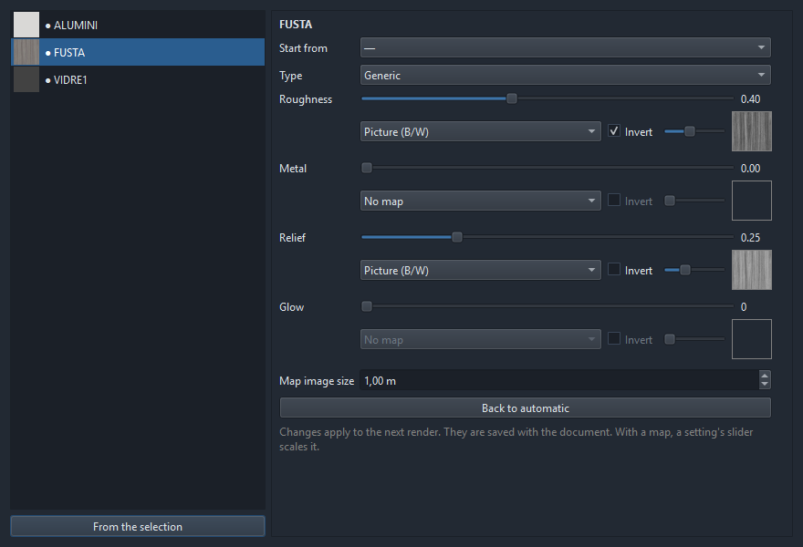

# Render Studio for IngeTrazo

Enscape-like renders from IngeTrazo with one click: pick a look, press
**Render**, then fine-tune the image live without rendering again.

It drives the same Blender that IngeTrazo's own Render tab uses (Blender
4.2+; tested with 5.3), with IngeTrazo's scene script plus
`blender/studio_scene.py` for the look.

## Looks

| Look | What it does |
|---|---|
| Clear day | Physical sky, sun coloured by its height, a few clouds |
| Partly cloudy | More cloud, softer sun |
| Golden hour | Low warm sun (7°), long shadows, punchier contrast |
| Overcast | Soft sun through full cloud cover, low contrast |
| White model | Every material white (study model), neutral finish |
| Interior | Exposed for the room, window allowed to burn out; switches to **Cycles** (EEVEE can't fill a window-lit room) |
| Night | Moonlight kept dark, stars and moonlit clouds; the document's lamps glow (light bloom) |

Every look shares:
- **Automatic exposure.** A quarter-size pre-render is metered, with a
  centre-weighted average and highlights protected.
- **AgX** tone mapping with white balance.
- **Distance haze.** The ground fades into the horizon sky.
- **Albedo capped at 80 %.** Paper-white surfaces don't glow under a path tracer.
- **Finish.** A light saturation and vignette pass in Blender's compositor.
- **EEVEE gets a ground below the horizon in its world.** Its reflections
  and the light bounced off the ground then match Cycles.

## Materials

**Materials…**, on the panel or in the menu, opens a simple material
editor, like Enscape's. The list shows the materials used in the model.
**From the selection** jumps to the material of the selected face or group.

For each material you can:
- start from a preset: matte plaster, satin paint, gloss lacquer, polished
  stone, concrete, brick, varnished or raw wood, fabric, brushed metal,
  chrome, clear or frosted glass, water, or a light panel;
- set its **type**: generic, glass, water or glowing;
- adjust **Roughness**, **Metal**, **Relief** and **Glow**, each with an optional map.

Relief comes from the material's picture when it has one (mortar joints,
wood grain), otherwise from a fine grain. A glowing material lights what
is around it, and the exposure meter ignores it, so it doesn't darken the
picture.

### Change the picture, in the model

**Change picture…** in the material editor replaces the picture of the material **in the
IngeTrazo model itself**, not only in the render: every face, component and object that wears
the material changes, in the viewport too, as one undo step. Each face keeps where its texture
was placed, and a colour tint is kept over the new image. **Keep proportions** makes the tile
height follow the new image's shape. The new image is copied into IngeTrazo's texture cache and
travels with the document. It needs a material that already has a picture. This is the one
control of Render Studio that edits IngeTrazo's own material; every other setting only affects
the render.

### Maps

Each setting can vary over the surface by following a map. The setting's
slider then scales the map. A map can come from:
- **Picture (B/W)**: the material's own texture in black and white. For
  example, a wood texture's grain for its roughness and relief.
- **Image file**: a roughness, metal or height map, or a mask for where it
  glows. Relief also takes a **normal map**.

Every map can be **inverted** and given more **contrast**, and a small
preview shows what the render will read. Map files follow the picture's
own size and placement. On a material without a picture, they tile at the
**Map image size**.

The settings are saved in the document, one undo step per change. **Back
to automatic** returns the material to IngeTrazo's own finish. Map files
are linked by their path, not embedded in the document.

## 360° background (HDRI)

Any equirectangular image (.hdr, .exr, .jpg) as the world:
- **Lights the scene** (on): the image lights the model, and its sun casts
  the shadows. The look's sky and sun are replaced; its exposure and
  finish stay.
- **Lights the scene** (off): the look lights the model, and the image is
  only what the camera sees behind it.
- **Rotation** turns the image, and **Brightness** sets it in stops.
- The ground melts into the image's horizon.

Blender's own eight HDRIs (CC0, Poly Haven) are offered in the list. They
are 1K: good light, but soft behind the model. For a sharp background,
choose a 4K or larger file, for example a free one from polyhaven.com.

## Panel

`Render Studio…` in the extensions menu opens the panel. It has:
- the look;
- the engine: EEVEE (fast, about 3 s) or Cycles (best, about 5 s on an RTX GPU);
- the quality and the width;
- sliders that change the render itself: exposure (EV), clouds, sun, warmth,
  saturation and vignette;
- a 360° background (HDRI), with rotation, brightness and "Lights the scene".

The finished image opens in its own window. There you can adjust
exposure, contrast, saturation, warmth and vignette instantly, then save
the image as PNG or JPEG.

## Help

A **?** button in the panel, in the image window and in the material editor opens a help
window (with search) at the right section: how Render Studio works, every control, the looks,
the 360° background, the image adjustments, the material editor with its maps and starting
points, and a few tips.

## Install

Copy the `render_studio` folder into IngeTrazo's plugins folder
(`%APPDATA%\IngeTrazo\plugins` on Windows), then restart IngeTrazo. It
requires Extension API 2 and a Blender that IngeTrazo can find (set in the
Render tab).

## Tests

- `tests/test_texture_swap_offline.py` changes a material's picture on loose faces, nested
  components and painted objects, and checks placement, proportions, tint, undo and save/reopen.
- `tests/test_help_offline.py` checks the help against the code.
- `tests/test_offline.py` writes a job with the panel's own code and
  renders it with Blender. It then adjusts and saves the image in the image
  window, without IngeTrazo running.
- `selftest.py` runs inside a real, separate IngeTrazo. Start it with
  `RENDER_STUDIO_SELFTEST=<config.json> ingetrazo --new-window`. It
  renders every look through the Render button code, saves the pictures
  and quits without saving.

## Licence

GPL-3.0-or-later, like IngeTrazo.
